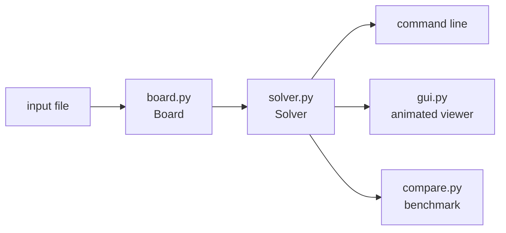

<a id="english"></a>

<div align="center">

# 🧩 8-Puzzle Solver

**BFS · DFS · Uniform-Cost Search · A\*** on the sliding-tile puzzle, with a command-line tool and an animated viewer.


**English** · [فارسی](#persian)

</div>

<!-- Add a screenshot of the viewer here:   -->

---

## 📖 Overview

The 8-puzzle is a 3×3 board with eight numbered tiles and one blank square. In each move you slide a tile that is next to the blank into it. The goal is to arrange the tiles in row order, `1 2 3 / 4 5 6 / 7 8 _`, with the blank in the bottom-right corner.

This project solves it (and any n×n version) with four classic search algorithms and lets you compare them. It was written as **mini-project 1 of the Artificial Intelligence and Expert Systems course** at Yazd University.

## ✨ Features

- An immutable `Board` type with Hamming and Manhattan distances (Manhattan is cached), neighbor generation, equality and hashing, and an exact solvability test.
- Four algorithms behind one `Solver` class: **BFS**, **DFS**, **UCS** (moving tile *k* costs *k*) and **A\*** (Manhattan or Hamming).
- Unsolvable boards are detected **before** any search starts.
- The solution path is rebuilt through parent links, so you get every board from start to goal.
- A command-line interface, a benchmark script, and an **animated Tkinter viewer** (bonus part).
- No third-party packages: standard library only.

## 🗂️ Project structure

```
puzzle8/
├── board.py        # Board: representation, distances, neighbors, solvability, file reading
├── solver.py       # Node, Solver (BFS / DFS / UCS / A*) and the command-line interface
├── gui.py          # Tkinter viewer with animation (bonus)
├── compare.py      # benchmark of all algorithms on a few boards
├── inputs/         # sample puzzles
│   ├── solvable.txt
│   ├── unsolvable.txt
│   ├── medium.txt
│   └── hard.txt
└── README.md
```



## 🚀 Getting started

You only need Python 3.8 or newer. Tkinter ships with the standard Windows and macOS installers (only needed for the viewer).

```bash
git clone https://github.com/<your-username>/puzzle8.git
cd puzzle8
python solver.py inputs/solvable.txt
```

### Command line

```bash
python solver.py <file> [-a {bfs,dfs,ucs,astar}] [-H {manhattan,hamming}] [--stats] [--no-path]
```

| Option | Meaning | Default |
|---|---|---|
| `-a`, `--algorithm` | search algorithm | `astar` |
| `-H`, `--heuristic` | heuristic used by A\* | `manhattan` |
| `--stats` | also print the number of expanded nodes | off |
| `--no-path` | print only the summary, not every board | off |

```bash
python solver.py inputs/solvable.txt                          # A* with Manhattan
python solver.py inputs/medium.txt -a bfs --stats --no-path   # BFS, summary only
python solver.py inputs/medium.txt -a ucs --stats --no-path   # uniform-cost search
python solver.py inputs/hard.txt -a astar -H hamming --stats --no-path
python solver.py inputs/unsolvable.txt                        # Unsolvable puzzle
```

> ⚠️ DFS finds very long paths (tens of thousands of moves). Always add `--no-path` when you try it.

### Input format

The first number is the board size `n`, followed by `n` rows of `n` numbers. `0` is the blank.

```
3
0 1 3
4 2 5
7 8 6
```

Persian digits (`۰ ۱ ۲ …`) are accepted too.

### Output

```
Minimum number of moves = 4

3
0 1 3
4 2 5
7 8 6

3
1 0 3
4 2 5
7 8 6

3
1 2 3
4 0 5
7 8 6

3
1 2 3
4 5 0
7 8 6

3
1 2 3
4 5 6
7 8 0
```

Unsolvable input prints `Unsolvable puzzle`. For UCS the output shows both the number of moves and the minimum total cost; for DFS it states that the result is not necessarily minimal.

### Animated viewer

```bash
python gui.py
```

Open a puzzle file or press **Random**, choose an algorithm and press **Solve**. Then play the solution, step through it with the arrow keys, or drag the slider to any step. Tiles turn green when they reach their goal cell, and Hamming and Manhattan distances of the current board are shown live.

### As a library

```python
from board import Board
from solver import Solver

board = Board([[0, 1, 3], [4, 2, 5], [7, 8, 6]])
solver = Solver(board, "astar", "manhattan")

print(solver.moves())               # 4
for step in solver.solution():      # every board from start to goal
    print(step, end="\n\n")
```

### Tests and benchmark

```bash
python board.py     # direct tests of every public Board method
python compare.py   # all algorithms on three boards
```

## 🧠 How it works

### Board

| Method | Purpose |
|---|---|
| `Board(tiles)` | build a board from a 2D list; validates size and tiles |
| `size()`, `tile_at(row, col)`, `__str__()` | basic access and text form (`tile_at` raises `IndexError` outside the board) |
| `hamming()` | number of non-blank tiles that are not in their goal cell |
| `manhattan()` | sum of horizontal + vertical distances of the tiles to their goal cells (**cached** at construction) |
| `is_goal()` | is this exactly the goal board? |
| `__eq__`, `__hash__` | compare by size and tiles, so boards can live in sets and dicts |
| `neighbors()` | every board reachable in one legal move; always **new** `Board` objects |
| `is_solvable()` | exact solvability test using inversions |

### Detecting unsolvable boards

Read the tiles row by row, ignoring the blank. Every pair where a larger tile comes before a smaller one is an *inversion*.

- **n odd:** solvable ⇔ the number of inversions is even.
- **n even:** solvable ⇔ inversions + (row of the blank, counted from 0 at the top) is odd.

A horizontal move never changes the order of the tiles, and a vertical move changes the inversion count by an amount that keeps this parity invariant, so exactly half of all arrangements can reach the goal.

### Algorithms

| Algorithm | Frontier | Priority | Result |
|---|---|---|---|
| **BFS** | FIFO queue | depth | fewest moves |
| **DFS** | stack | none | any path, usually very long |
| **UCS** | priority queue | `g` (tile *k* costs *k*) | cheapest total cost |
| **A\*** | priority queue | `f = g + h` | fewest moves (with an admissible `h`) |

- BFS and DFS share one function; only the end of the `deque` they take from differs.
- UCS and A\* share another one; UCS is A\* with `h = 0` and a different step cost.
- A\* tests for the goal when a node is **popped**, not when it is created, which is what guarantees optimality. BFS can test earlier because every move costs the same.
- Both Hamming and Manhattan never overestimate the true remaining cost, so A\* stays optimal with either. Manhattan is more informed and expands far fewer nodes.
- Every search node stores its board, move count, cost, priority and a link to its parent.

### Optimizations

1. **No immediate undo.** A child equal to the board its parent came from is skipped. Without a visited set, this matters a lot: counting the nodes of a plain search tree from `inputs/medium.txt`,

   | Depth | Without | With |
   |---|---:|---:|
   | 6 | 768 | 64 |
   | 10 | 49,152 | 544 |
   | 14 | 3,145,728 | 4,768 |

   (The solver also keeps a visited/closed set, which already removes these repeats; the explicit check is kept as the assignment requires and saves a few hash lookups.)

2. **Cached Manhattan.** The value is computed once in the constructor. Reading it is roughly 50× faster than recomputing it.

## 📊 Results

Measured with `python compare.py`. *Moves* is the length of the returned path, *cost* is the sum of the numbers of the tiles moved, *expanded* is the number of nodes the search opened.

**Medium board** (`inputs/medium.txt`, shortest solution: 14 moves)

| Algorithm | Moves | Cost | Expanded |
|---|---:|---:|---:|
| BFS | 14 | 73 | 3,633 |
| DFS | 63,906 | 286,983 | 83,658 |
| UCS | 18 | **71** | 16,335 |
| A\* (Hamming) | 14 | 73 | 301 |
| A\* (Manhattan) | 14 | 73 | **76** |

**Harder board** (`[[1,2,6],[4,0,7],[3,5,8]]`, shortest solution: 20 moves)

| Algorithm | Moves | Cost | Expanded |
|---|---:|---:|---:|
| BFS | 20 | 84 | 41,363 |
| DFS | 23,898 | 107,826 | 24,871 |
| UCS | 20 | 84 | 43,497 |
| A\* (Hamming) | 20 | 88 | 4,252 |
| A\* (Manhattan) | 20 | 88 | **728** |

What the numbers show:

- A\* with Manhattan opens about **57× fewer nodes** than BFS on the 20-move board and still finds a shortest path.
- DFS is not optimal at all: tens of thousands of moves for puzzles that need 4 to 20.
- UCS minimizes **cost**, not moves: on the medium board it takes 4 extra moves to save 2 units of cost.
- The hardest 3×3 instances need 31 moves; `inputs/hard.txt` is one of them and A\* solves it by expanding about 20 thousand nodes.

Expanded counts depend on the order in which neighbors are generated (up, down, left, right of the blank), while the quality of the result does not.

## 📝 Notes

- Coordinates are zero-based: `tile_at(0, 0)` is the top-left cell.
- The goal board for size n is `1 … n²-1` in row order with the blank last.
- `Board` objects are immutable, so they are safe as dictionary keys and are never modified by `neighbors()`.

## 👤 Author

Amirreza Rajaei, Artificial Intelligence and Expert Systems course, Yazd University.

---

<a id="persian"></a>

<div dir="rtl">

<div align="center">

# 🧩 حل‌کننده‌ی پازل هشت‌تایی

**BFS · DFS · هزینه یکنواخت · A\*** روی پازل لغزشی، با ابزار خط فرمان و نمایش گرافیکی متحرک.

[English](#english) · **فارسی**

</div>

---

## 📖 معرفی

پازل هشت‌تایی یک صفحه‌ی ۳×۳ با هشت کاشی شماره‌دار و یک خانه‌ی خالی است. در هر حرکت، یکی از کاشی‌های مجاور خانه‌ی خالی را داخل آن می‌لغزانیم. هدف این است که کاشی‌ها به ترتیب سطری `1 2 3 / 4 5 6 / 7 8 _` چیده شوند و خانه‌ی خالی در گوشه‌ی پایین‌راست بماند.

این پروژه پازل (و نسخه‌ی n×n آن) را با چهار الگوریتم جست‌وجوی کلاسیک حل می‌کند و امکان مقایسه‌ی آن‌ها را می‌دهد. پروژه به‌عنوان **مینی‌پروژه‌ی اول درس هوش مصنوعی و سیستم‌های خبره** در دانشگاه یزد نوشته شده است.

## ✨ امکانات

- نوع داده‌ی `Board` تغییرناپذیر، با فاصله‌های Hamming و Manhattan (مقدار Manhattan کش می‌شود)، تولید همسایه‌ها، مقایسه و hash، و تشخیص دقیق قابل‌حل‌بودن.
- چهار الگوریتم در یک کلاس `Solver`: **BFS** و **DFS** و **UCS** (هزینه‌ی جابه‌جایی کاشی *k* برابر *k*) و **A\*** (با Manhattan یا Hamming).
- صفحه‌های غیرقابل‌حل **پیش از شروع جست‌وجو** تشخیص داده می‌شوند.
- مسیر جواب با پیوندهای گره قبلی بازسازی می‌شود، پس همه‌ی صفحه‌ها از ابتدا تا هدف نمایش داده می‌شوند.
- رابط خط فرمان، برنامه‌ی مقایسه‌ی الگوریتم‌ها و **نمایش گرافیکی متحرک با Tkinter** (بخش امتیازی).
- بدون هیچ بسته‌ی خارجی: فقط کتابخانه‌ی استاندارد پایتون.

## 🗂️ ساختار پروژه

```
puzzle8/
├── board.py        # Board: نمایش صفحه، فاصله‌ها، همسایه‌ها، قابل‌حل‌بودن، خواندن فایل
├── solver.py       # Node و Solver (BFS / DFS / UCS / A*) و رابط خط فرمان
├── gui.py          # نمایش گرافیکی متحرک با Tkinter (امتیازی)
├── compare.py      # مقایسه‌ی الگوریتم‌ها روی چند صفحه
├── inputs/         # نمونه ورودی‌ها
│   ├── solvable.txt
│   ├── unsolvable.txt
│   ├── medium.txt
│   └── hard.txt
└── README.md
```


## 🚀 شروع سریع

فقط به پایتون ۳.۸ یا بالاتر نیاز دارید. Tkinter همراه نصب‌کننده‌ی استاندارد ویندوز و macOS می‌آید (فقط برای نمایش گرافیکی لازم است).

```bash
git clone https://github.com/<your-username>/puzzle8.git
cd puzzle8
python solver.py inputs/solvable.txt
```

### خط فرمان

```bash
python solver.py <file> [-a {bfs,dfs,ucs,astar}] [-H {manhattan,hamming}] [--stats] [--no-path]
```

| گزینه | معنی | پیش‌فرض |
|---|---|---|
| `-a`, `--algorithm` | الگوریتم جست‌وجو | `astar` |
| `-H`, `--heuristic` | تابع تخمین مورد استفاده‌ی A\* | `manhattan` |
| `--stats` | چاپ تعداد گره‌های بازشده | خاموش |
| `--no-path` | فقط خلاصه، بدون چاپ همه‌ی صفحه‌ها | خاموش |

```bash
python solver.py inputs/solvable.txt                          # A* با Manhattan
python solver.py inputs/medium.txt -a bfs --stats --no-path   # BFS، فقط خلاصه
python solver.py inputs/medium.txt -a ucs --stats --no-path   # هزینه یکنواخت
python solver.py inputs/hard.txt -a astar -H hamming --stats --no-path
python solver.py inputs/unsolvable.txt                        # Unsolvable puzzle
```

> ⚠️ DFS مسیرهای بسیار طولانی (ده‌ها هزار حرکت) پیدا می‌کند. هنگام امتحان آن حتماً `--no-path` را اضافه کنید.

### قالب فایل ورودی

عدد اول اندازه‌ی صفحه `n` است و بعد از آن `n` سطر که هر کدام `n` عدد دارند. عدد `0` خانه‌ی خالی است.

```
3
0 1 3
4 2 5
7 8 6
```

رقم‌های فارسی (`۰ ۱ ۲ …`) هم پذیرفته می‌شوند.

### خروجی

```
Minimum number of moves = 4

3
0 1 3
4 2 5
7 8 6

3
1 0 3
4 2 5
7 8 6

3
1 2 3
4 0 5
7 8 6

3
1 2 3
4 5 0
7 8 6

3
1 2 3
4 5 6
7 8 0
```

برای ورودی غیرقابل‌حل عبارت `Unsolvable puzzle` چاپ می‌شود. در UCS هم تعداد حرکت‌ها و هم کمینه‌ی هزینه‌ی کل نمایش داده می‌شود و در DFS اعلام می‌شود که نتیجه لزوماً کمینه نیست.

### نمایش گرافیکی متحرک

```bash
python gui.py
```

یک فایل پازل باز کنید یا **Random** را بزنید، الگوریتم را انتخاب کنید و **Solve** را بزنید. سپس جواب را پخش کنید، با کلیدهای چپ و راست قدم‌به‌قدم جلو بروید یا اسلایدر را به هر مرحله ببرید. کاشی‌ها وقتی به خانه‌ی هدفشان می‌رسند سبز می‌شوند و فاصله‌های Hamming و Manhattan صفحه‌ی فعلی به‌صورت زنده نمایش داده می‌شوند.

### استفاده به‌عنوان کتابخانه

```python
from board import Board
from solver import Solver

board = Board([[0, 1, 3], [4, 2, 5], [7, 8, 6]])
solver = Solver(board, "astar", "manhattan")

print(solver.moves())               # 4
for step in solver.solution():      # همه‌ی صفحه‌ها از ابتدا تا هدف
    print(step, end="\n\n")
```

### تست و مقایسه

```bash
python board.py     # تست مستقیم همه‌ی متدهای عمومی Board
python compare.py   # همه‌ی الگوریتم‌ها روی سه صفحه
```

## 🧠 نحوه‌ی کار

### Board

| متد | وظیفه |
|---|---|
| `Board(tiles)` | ساخت صفحه از آرایه‌ی دوبعدی؛ اندازه و کاشی‌ها را اعتبارسنجی می‌کند |
| `size()` و `tile_at(row, col)` و `__str__()` | دسترسی پایه و نمایش متنی (`tile_at` برای مختصات بیرون از صفحه `IndexError` می‌دهد) |
| `hamming()` | تعداد کاشی‌های غیرخالی که در خانه‌ی هدف خود نیستند |
| `manhattan()` | مجموع فاصله‌ی افقی و عمودی کاشی‌ها تا خانه‌ی هدفشان (هنگام ساخت **کش** می‌شود) |
| `is_goal()` | آیا صفحه دقیقاً همان هدف است؟ |
| `__eq__` و `__hash__` | مقایسه بر اساس اندازه و کاشی‌ها؛ برای استفاده در set و dict |
| `neighbors()` | همه‌ی صفحه‌هایی که با یک حرکت مجاز به دست می‌آیند؛ همیشه شیءهای **جدید** |
| `is_solvable()` | تشخیص دقیق قابل‌حل‌بودن با وارونگی‌ها |

### تشخیص صفحه‌های غیرقابل‌حل

کاشی‌ها را سطر به سطر می‌خوانیم و خانه‌ی خالی را نادیده می‌گیریم. هر جفتی که کاشی بزرگ‌تر پیش از کوچک‌تر آمده باشد یک *وارونگی* است.

- **n فرد:** حل‌شدنی است ⇔ تعداد وارونگی‌ها زوج باشد.
- **n زوج:** حل‌شدنی است ⇔ وارونگی‌ها + سطر خانه‌ی خالی (با شمارش از صفر در بالا) فرد باشد.

حرکت افقی ترتیب کاشی‌ها را تغییر نمی‌دهد و حرکت عمودی تعداد وارونگی‌ها را طوری عوض می‌کند که این زوج/فرد بودن حفظ شود. به همین دلیل دقیقاً نیمی از چیدمان‌ها می‌توانند به هدف برسند.

### الگوریتم‌ها

| الگوریتم | ساختار فهرست انتظار | اولویت | نتیجه |
|---|---|---|---|
| **BFS** | صف (اول‌وارد، اول‌خارج) | عمق | کمترین تعداد حرکت |
| **DFS** | پشته | ندارد | یک مسیر دلخواه، معمولاً بسیار طولانی |
| **UCS** | صف اولویت | `g` (کاشی *k* هزینه‌ی *k*) | کمترین هزینه‌ی کل |
| **A\*** | صف اولویت | `f = g + h` | کمترین تعداد حرکت (با `h` قابل‌قبول) |

- BFS و DFS یک تابع مشترک دارند و فقط سمتی از `deque` که از آن برمی‌دارند فرق می‌کند.
- UCS و A\* هم تابع مشترک دارند؛ UCS همان A\* با `h = 0` و هزینه‌ی گام متفاوت است.
- A\* آزمون هدف را هنگام **خروج** گره از صف انجام می‌دهد، نه هنگام ساخته شدنش، و بهینگی از همین‌جا تضمین می‌شود. BFS می‌تواند زودتر آزمون کند چون هزینه‌ی همه‌ی حرکت‌ها برابر است.
- Hamming و Manhattan هیچ‌کدام هزینه‌ی باقی‌مانده را بیش از مقدار واقعی تخمین نمی‌زنند، پس A\* با هر دو بهینه می‌ماند. Manhattan اطلاعات بیشتری دارد و گره‌های خیلی کمتری باز می‌کند.
- هر گره‌ی جست‌وجو صفحه، تعداد حرکت، هزینه، اولویت و پیوند به گره‌ی قبلی را نگه می‌دارد.

### بهینه‌سازی‌ها

۱. **جلوگیری از برگشت فوری.** فرزندی که با صفحه‌ی قبلیِ مسیر (یعنی صفحه‌ای که از آن آمده‌ایم) برابر باشد کنار گذاشته می‌شود. بدون مجموعه‌ی دیده‌شده‌ها اثر این کار بسیار زیاد است. اگر گره‌های یک درخت جست‌وجوی ساده را از `inputs/medium.txt` بشماریم:

   | عمق | بدون حذف | با حذف |
   |---|---:|---:|
   | ۶ | 768 | 64 |
   | ۱۰ | 49,152 | 544 |
   | ۱۴ | 3,145,728 | 4,768 |

   (حل‌کننده یک مجموعه‌ی دیده‌شده/بسته هم دارد که این تکرارها را از قبل حذف می‌کند؛ بررسی صریح مطابق خواسته‌ی پروژه نگه داشته شده و چند جست‌وجوی hash را کم می‌کند.)

۲. **کش‌کردن Manhattan.** مقدار فقط یک‌بار در سازنده محاسبه می‌شود. خواندن آن تقریباً ۵۰ برابر سریع‌تر از محاسبه‌ی دوباره است.

## 📊 نتایج

با `python compare.py` اندازه‌گیری شده است. *Moves* طول مسیر برگردانده‌شده، *cost* مجموع شماره‌ی کاشی‌های جابه‌جاشده و *expanded* تعداد گره‌هایی است که جست‌وجو باز کرده است.

**صفحه‌ی متوسط** (`inputs/medium.txt`، کوتاه‌ترین جواب: ۱۴ حرکت)

| الگوریتم | Moves | Cost | Expanded |
|---|---:|---:|---:|
| BFS | 14 | 73 | 3,633 |
| DFS | 63,906 | 286,983 | 83,658 |
| UCS | 18 | **71** | 16,335 |
| A\* (Hamming) | 14 | 73 | 301 |
| A\* (Manhattan) | 14 | 73 | **76** |

**صفحه‌ی سخت‌تر** (`[[1,2,6],[4,0,7],[3,5,8]]`، کوتاه‌ترین جواب: ۲۰ حرکت)

| الگوریتم | Moves | Cost | Expanded |
|---|---:|---:|---:|
| BFS | 20 | 84 | 41,363 |
| DFS | 23,898 | 107,826 | 24,871 |
| UCS | 20 | 84 | 43,497 |
| A\* (Hamming) | 20 | 88 | 4,252 |
| A\* (Manhattan) | 20 | 88 | **728** |

اعداد نشان می‌دهند:

- A\* با Manhattan روی صفحه‌ی ۲۰ حرکتی حدود **۵۷ برابر گره‌ی کمتر** از BFS باز می‌کند و باز هم کوتاه‌ترین مسیر را پیدا می‌کند.
- DFS اصلاً بهینه نیست: ده‌ها هزار حرکت برای پازل‌هایی که ۴ تا ۲۰ حرکت جواب دارند.
- UCS **هزینه** را کمینه می‌کند، نه تعداد حرکت‌ها: در صفحه‌ی متوسط ۴ حرکت اضافه می‌رود تا ۲ واحد از هزینه کم شود.
- سخت‌ترین چیدمان‌های ۳×۳ به ۳۱ حرکت نیاز دارند؛ `inputs/hard.txt` یکی از آن‌هاست و A\* آن را با باز کردن حدود بیست هزار گره حل می‌کند.

تعداد گره‌های بازشده به ترتیب تولید همسایه‌ها (بالا، پایین، چپ، راست خانه‌ی خالی) بستگی دارد، ولی کیفیت جواب به آن وابسته نیست.

## 📝 نکته‌ها

- مختصات از صفر شروع می‌شود: `tile_at(0, 0)` خانه‌ی بالا-چپ است.
- صفحه‌ی هدف برای اندازه‌ی n برابر `1 … n²-1` به ترتیب سطری است و خانه‌ی خالی آخر می‌آید.
- شیءهای `Board` تغییرناپذیرند، پس می‌توانند کلید دیکشنری باشند و `neighbors()` هیچ‌گاه آن‌ها را تغییر نمی‌دهد.

## 👤 سازنده

امیررضا رجائی، درس هوش مصنوعی و سیستم‌های خبره، دانشگاه یزد.

</div>
